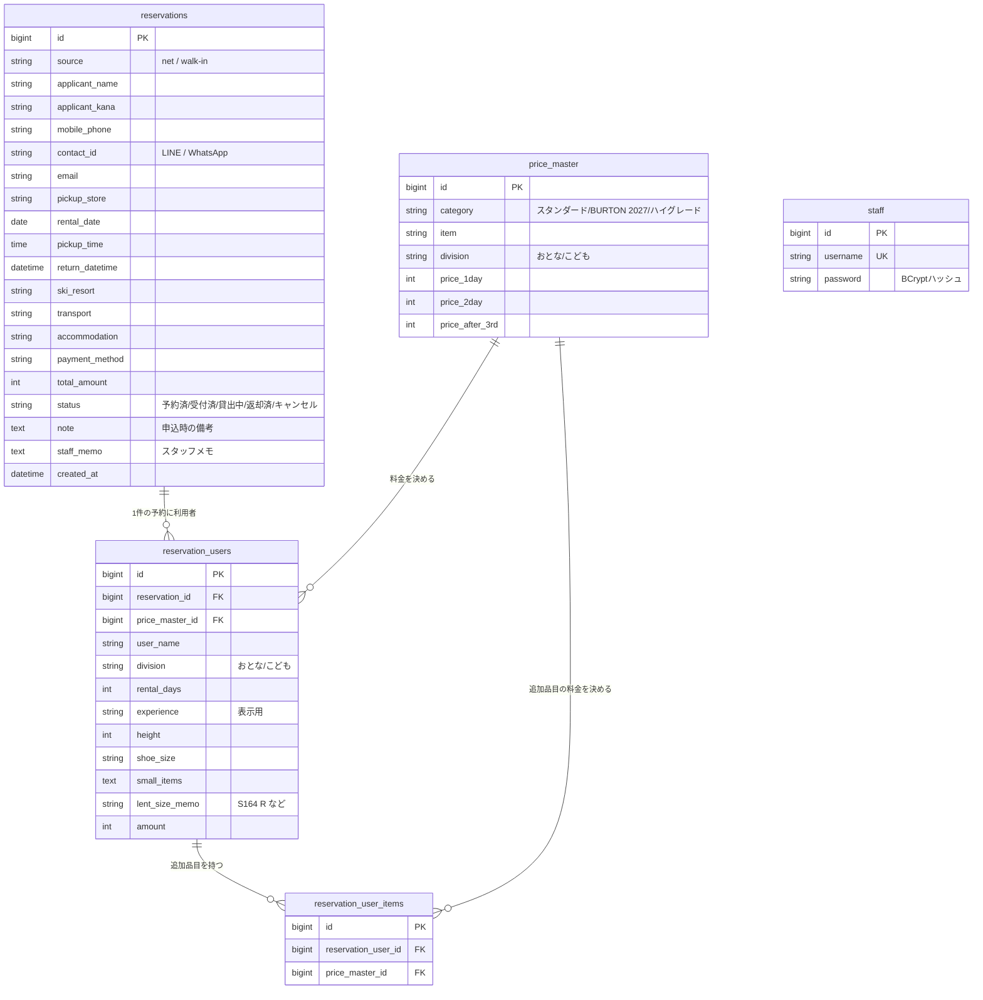
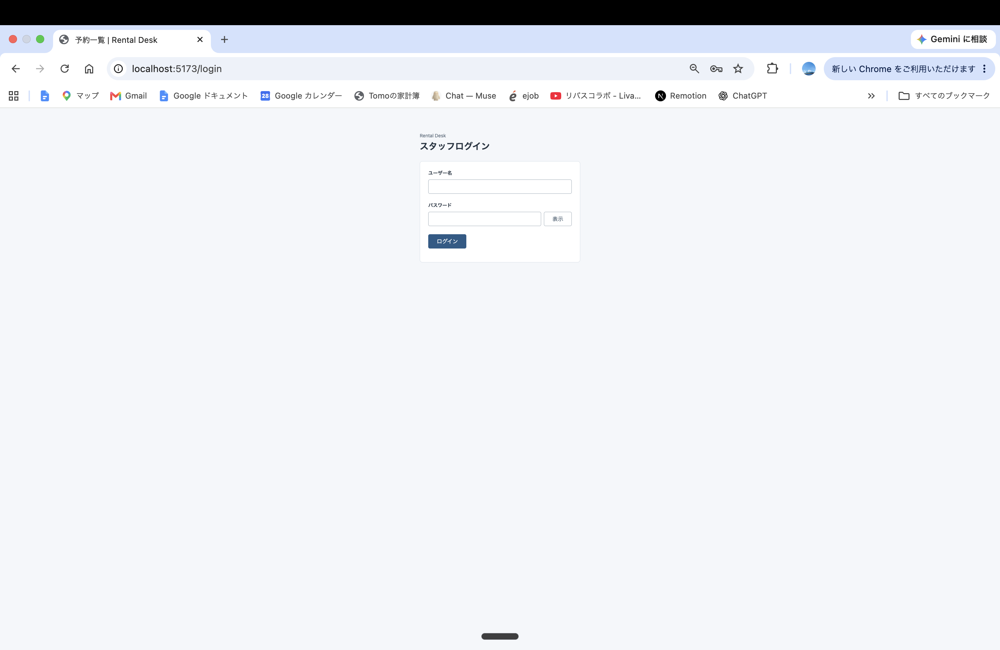
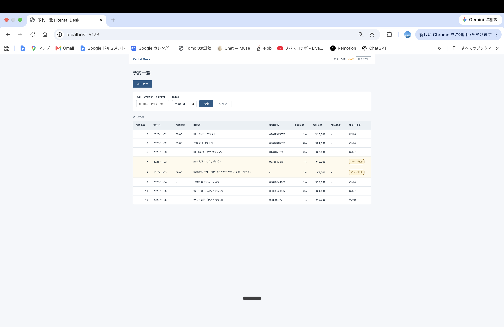
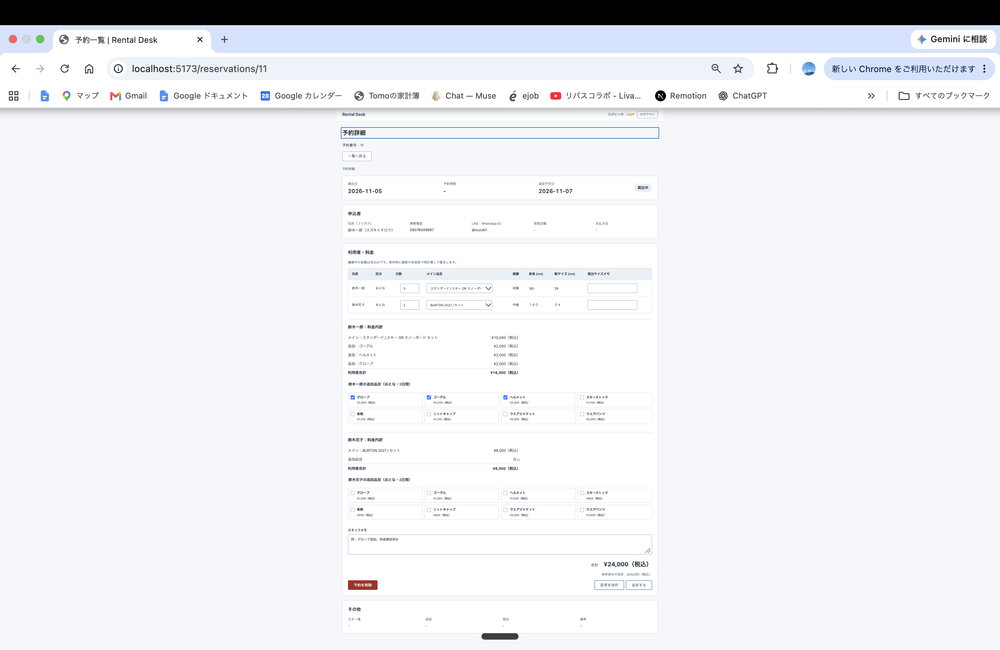
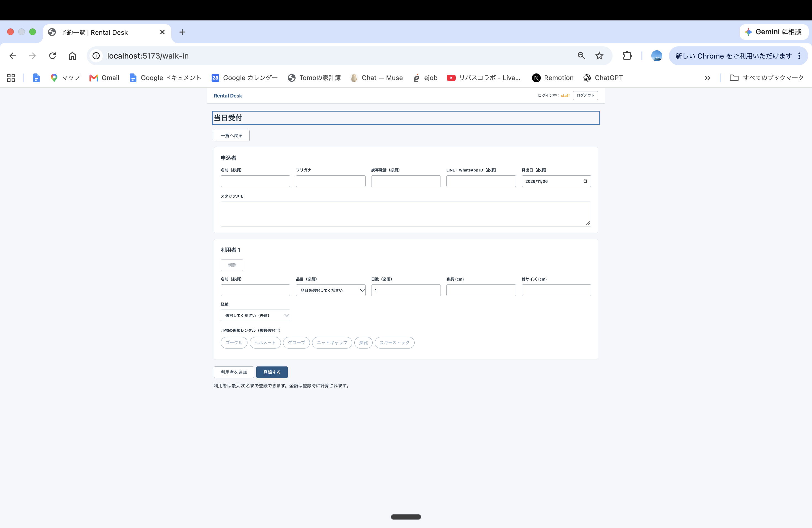

# Rental Desk

スキー・スノーボードレンタル店の受付を、紙からデジタルへ。朝の受付をスムーズに流すための受付管理アプリ。

## アプリケーションの概要

スキー・スノーボードレンタル店の予約・受付・貸出・返却を管理するWebアプリです。
「本日の予約一覧」から名前・フリガナ・予約番号で検索し、受付（貸出）と返却を記録できます。
料金は料金表（料金マスタ）をもとに自動計算されるため、暗記や電卓での計算が不要になります。

## 開発した背景や理由

- 以前働いていたレンタル店では、予約はメールを印刷して紙で管理し、当日の受付は手書きの申込書で行っていた
- 繁忙期は1日に100組近い予約があり、受付をするだけでも行列ができていた。大量の紙の予約メールから該当の予約を探すのにも時間がかかっていた
- 申込書には料金が書かれておらず、スタッフは料金を暗記するか、料金表を確認しながら電卓で計算していた
- 一番改善したかったのは、朝の受付が混み合う時間帯に、お客様の待ち時間を短縮し、スムーズにレンタル引渡しスタッフに流せるようにすること

## 主な機能

- 予約の登録・一覧・削除
- 氏名・フリガナ・予約番号での検索
- 受付・貸出・返却・キャンセルのステータス管理（予約済 → 受付済 → 貸出中 → 返却済）
- 料金の自動計算（料金マスタ参照：1日／2日／3日目以降の料金ルール）
- 当日来店のお客様の簡易登録（当日受付）
- スタッフログイン（セッションCookie方式、パスワードはBCryptで照合。表示／非表示は文字で切り替え）
- スタッフメモ（貸出サイズメモとは別項目。渡したサイズと現場のメモを分けて残す）
- 追加品目（小物の追加レンタル。チップで複数選択可）
- 「合計」（編集中の見込み額）と「保存済みの合計」（確定額）の併記
- 全画面共通のヘッダーバー（アプリ名、ログイン中のユーザー名、ログアウトボタン）
- 画面ごとのURL（/login、/、/reservations/:id、/walk-in）

## 主な使用技術

- バックエンド：Java / Spring Boot
- フロントエンド：React（Vite）
- データベース：MySQL（Docker）
- その他：Git / GitHub

## ER図（Mermaid）



## デモ画像

### ログイン画面



### 予約一覧画面



### 予約詳細画面



### 当日受付画面



## ローカル環境での起動方法

### 1. データベース（MySQL）の起動

```bash
cd backend
docker compose up -d
```

### 2. バックエンドの起動

```bash
cd backend
./mvnw spring-boot:run
```

### 3. フロントエンドの起動（別のターミナルで）

```bash
cd frontend
npm install
npm run dev
```

ブラウザで http://localhost:5173 を開きます。
デモ用ログイン：ユーザー名 `staff` / パスワード `password1234`

## 工夫した点・苦労した点

・当日受付画面を実際に操作してみたところ、追加の小物料金が合計に含まれていないという大きな落とし穴に気づいた。完成直前だったが設計（ER図）から見直して、追加品目を複数選択できる仕組みに作り替えた
・料金の表示は、編集中の見込み額（合計）と、保存済みの確定額（保存済みの合計）を分けて表示した。受付の途中で一時離席することがあっても、見込み金額と確定した金額が画面に残るので、どこまで確定しているのかが分かり、会計ミスを防げるようにした

## 今後の課題

- 重複予約への備え：同じ内容の予約が2件登録され得るため、スタッフが予約一覧で「要確認」の印を付けて、来店前に確認できる仕組み
- 送迎バスの管理：行き先のスキー場ごとに乗車予定者を管理し、出発の通知をお客様の LINE・WhatsApp へ送る仕組み
- 海外のお客様向けの英語版の作成
