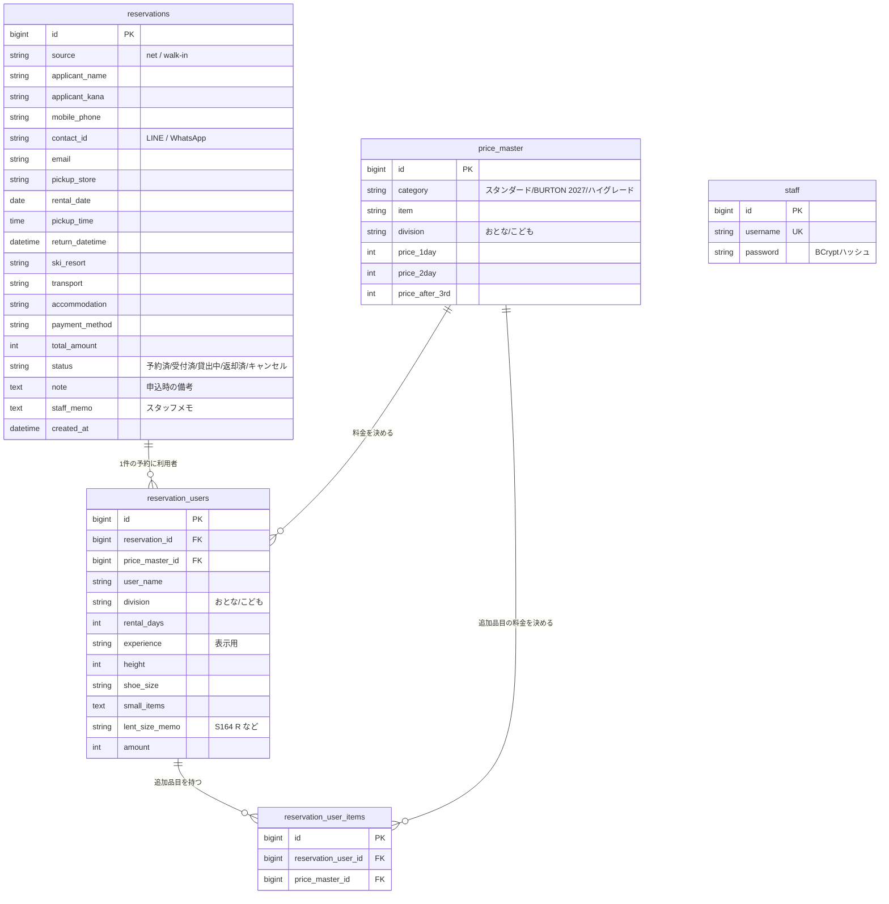

# Rental Desk 設計メモ（ER図・テーブル定義）

## 決定事項（2026-10-28）

- 画面は「予約一覧＋予約詳細」の2画面構成にする。一覧は朝の受付スピード優先で項目を絞り、返却予定日時・貸したサイズのメモ・料金内訳は詳細に置く
- ステータスは予約単位で管理する：予約済 → 受付済 → 貸出中 → 返却済（「受付済み」は入れず3状態。受付＝貸出中への変更で運用する）
- 当日来店の受付は簡易版をMVPに含める（名前・電話・品目・人数・貸出日・返却日。同じ予約テーブルに入れ、source で区別する）
- 料金の自動計算はMVPの必須とする。計算式：1日＝1日料金、2日＝2日料金、3日以上＝2日料金＋（日数−2）×3日目以降料金
- 連絡先は「当日に連絡がつく携帯電話番号」に加え、LINE ID／WhatsApp IDを持つ（お客様の約9割が海外の方で、携帯電話がつながらない場合があるため）
- 経験度は計算には使わず、用具準備の参考として表示用に持つ
- 支払いは利用者ごとの金額の合計で表す（1人ずつ払う場合も、代表者がまとめて払う場合も対応できる）

## テーブル定義

### reservations（予約）— 1件 ＝ 申込者1人

- id（PK）
- source：net / walk-in（ネット予約か当日客か）
- applicant_name, applicant_kana（検索は名前・フリガナ。ローマ字も想定）
- mobile_phone（当日に連絡がつく携帯電話番号）
- contact_id（LINE ID または WhatsApp ID）
- email
- pickup_store（受取店舗）
- rental_date, pickup_time, return_datetime
- ski_resort, transport, accommodation
- payment_method（ネット：来店時／PayPal、当日：現金／カード／PayPay）
- total_amount（利用者ごとの金額の合計、自動計算）
- status：予約済 / 受付済 / 貸出中 / 返却済 / キャンセル
- note（申込時の備考）
- staff_memo（スタッフの現場記録。申込時の備考とは分けて保存）
- created_at

### reservation_users（利用者）— 予約に1〜複数人（最大20人ほど）

- id（PK）
- reservation_id（FK → reservations.id）
- user_name, division：おとな / こども
- rental_days（利用日数）
- experience（経験度。表示用）
- height, shoe_size
- price_master_id（FK → price_master.id、主なレンタル品目）
- small_items（小物レンタル：ゴーグル／グローブ／ニットキャップ／ヘルメット／ストックなど）
- lent_size_memo（実際に貸した板・靴サイズのメモ）
  - 現場の簡易表記：スタンスはレギュラー＝R、グーフィー＝G
  - 板の表記：BURTON 2027系はスキー＝S164、スノーボード＝B165、Burtonボード＝BU165（記号＋長さcm）。ハイグレードは ES＝エキスパートスキー、EB＝エキスパートスノーボード
  - 略号ルールがあるため、自由記述（テキスト）で持つ
- amount（メイン品目の料金＋追加品目の料金の合計、自動計算）

### reservation_user_items（利用者の追加品目）— 利用者に0〜複数件

- id（PK）
- reservation_user_id（FK → reservation_users.id）
- price_master_id（FK → price_master.id、追加するレンタル品目）
- 追加品目は料金マスタを参照し、利用者の区分・日数で料金を計算する
- small_items は小物の候補選択・自由入力をまとめた文字列として保持する。料金計算の対象となる追加品目は、このテーブルで管理する

### price_master（料金マスタ）— 料金表CSV（docs/03-prices.csv）を投入

- id（PK）
- category：スタンダード / BURTON 2027 / ハイグレード
- item（品目）
- division：おとな / こども
- price_1day, price_2day, price_after_3rd（3日目以降・1日ごと）

### staff（スタッフ認証）

- id（PK）
- username（ユニーク）
- password（BCryptハッシュ。平文は保存しない）
- 他のテーブルとはリレーションなし。スタッフログインはセッションCookie方式で管理する

## リレーション

- reservations 1 — N reservation_users
- price_master 1 — N reservation_users
- reservation_users 1 — N reservation_user_items
- price_master 1 — N reservation_user_items
- reservation_users.amount の合計 ＝ reservations.total_amount

## ER図（Mermaid）

利用者の金額（reservation_users.amount）＝メイン品目の料金＋追加品目の料金の合計。
メイン品目・各追加品目とも、利用者の区分（おとな／こども）に対応する料金マスタと、利用者の日数（rental_days）で計算する。追加品目がない場合はメイン品目の料金のみとする。
予約の合計金額（reservations.total_amount）は、各利用者の金額の合計とする。

## 受付一覧の表示項目（絞る）

受付日・時間／受取店舗／申込者名（フリガナ）／電話／利用者数／主なレンタル内容／利用スキー場／合計金額／支払い方法／ステータス

## 変更履歴（2026-10-28 見直しで追加）
- ステータスを3状態から4状態に変更（予約済 → 受付済 → 貸出中 → 返却済）。理由：受付担当と引き渡し担当が分かれており、混雑時に「受付済みだが未引き渡し」の区別が必要なため
- 合計金額を予約一覧にも表示する。理由：日数で料金が変わり、会計時にその場で確認できる必要があるため
- 当日来店の簡易登録に貸出日・返却日を追加。理由：当日の貸出・返却の管理に必要なため
- 2026-11-03：キャンセル状態を追加。理由：キャンセルした予約も記録として残し、後から確認できるようにするため
